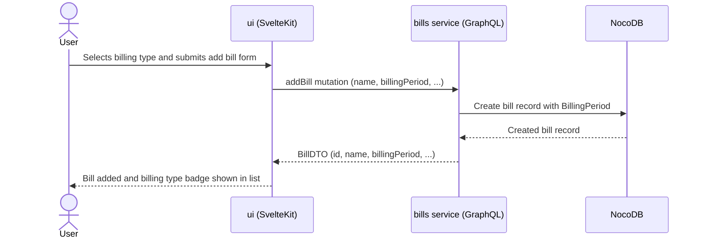
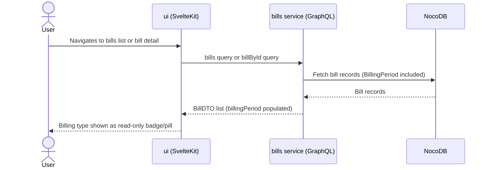
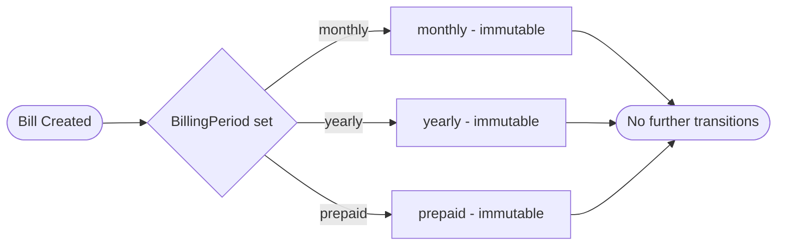

# High-Level Design: Bill Types

**Date**: 2026-06-13 | **Spec**: [spec.md](spec.md) | **Plan**: [plan.md](plan.md)

## Systems Involved

| System | Role | Change Required |
|--------|------|----------------|
| NocoDB (`bills` table) | Data store for bill records | None — billing type attribute already present |
| `bills` service (GraphQL API) | Exposes bill data; accepts bill creation requests | Bill creation contract must accept billing type as optional input; existing bill retrieval already returns it |
| `ui` (web application) | User-facing interface | Add bill form needs a billing type selector; bill list and detail views need a read-only billing type indicator |

**No new services or infrastructure components are introduced.**

## Data Flow: Create Bill with Billing Type

## Data Flow: View Bill

## Billing Type Lifecycle

## Immutability Constraint

Billing type is set at creation and never changed. This is enforced at the UI layer (no edit control shown) and by omission at the API layer (no update-billing-type operation exists).
