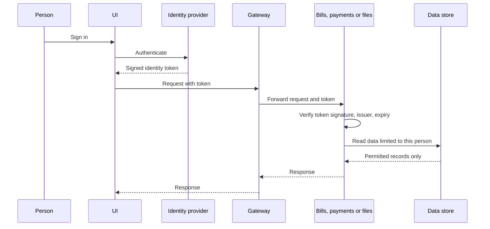
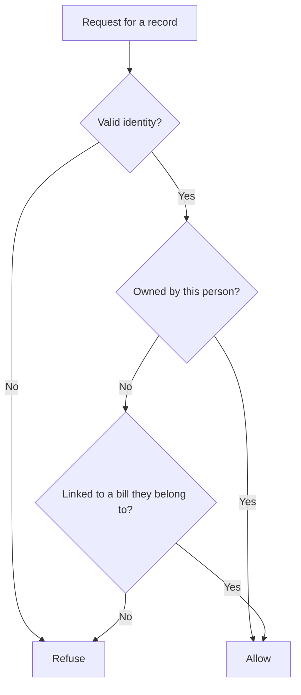
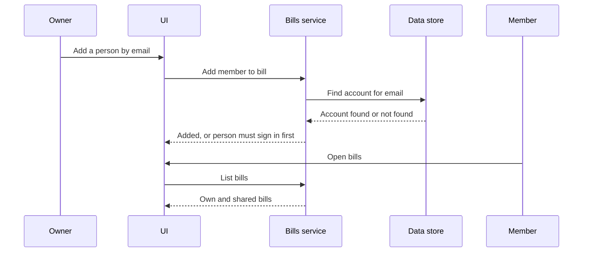

# High-Level Design: Multiple Users and Shared Bills

## Overview

People sign in through the existing identity provider. The UI sends proof of identity with every request, and each user-facing service verifies it independently and limits data to what that person may access. Sharing is a membership relationship between a person and a bill, stored alongside existing data.

## Systems

| System | Role in this feature |
|---|---|
| UI | Keeps a session, attaches identity to every request, adds sharing screens, clears device data on sign-out |
| Identity provider | Authenticates people and issues signed identity tokens. Unchanged except for requesting email |
| Gateway | Forwards identity to the services behind it |
| User service | Creates accounts on first sign-in and supplies names |
| Bills service | Limits bills, statements and payments to members, and manages membership |
| Payments service | Limits transactions, tags and trips to their owner or to bill members |
| Files service | Limits files to their uploader or to people who can access the linked record |
| Data store | Holds accounts, memberships and new owner fields |
| Syncer | Marks imported transactions with the configured import owner |
| Parsers and OCR | Unchanged. Internal only, not reachable from outside the cluster |

## Request flow

Requests that reach a service directly follow the same verification, so bypassing the gateway grants nothing.

## Access rules

Refusals look the same as a record that does not exist, so they reveal nothing about other people's data.

## Sharing flow

## Rollout

Each step leaves the first user working:

- Auth: release the UI so that it sends identity, release services that verify identity when present, then refuse requests without identity.
- Users: add new data fields, assign all existing records to the first user, then limit data to each person.
- Sharing: add memberships and sharing screens.
- Receipts: add receipt upload on the bill page, with no bill cycle.

## Out of scope

Cost splitting, ownership transfer, per-person imports, and a registration screen.
