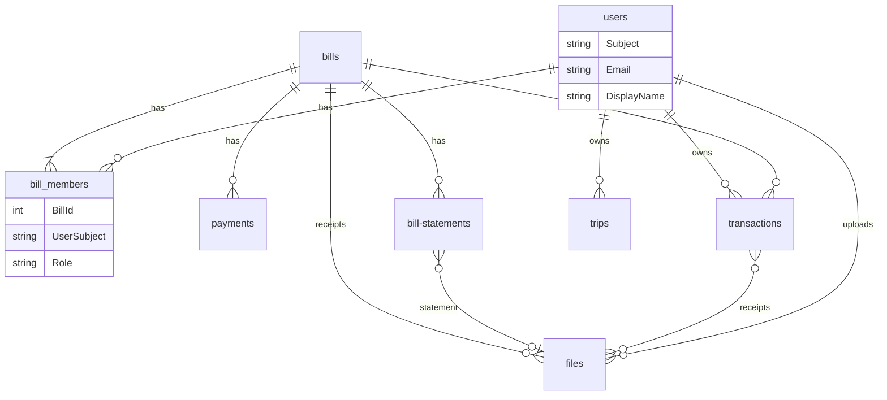

# Low-Level Design: Multiple Users and Shared Bills

## Data Model Changes

All in the NocoDB `payobills` base. `*Subject` columns hold the token `sub` value (see research R2).

| Table | Change | Columns |
|---|---|---|
| `users` | New | `Id`, `Subject` (unique), `Email` (unique), `DisplayName`, `CreatedAt`, `UpdatedAt` |
| `bill_members` | New | `Id`, `BillId`, `UserSubject`, `Role` (`owner` or `member`), `CreatedAt` |
| `transactions` | Add | `OwnerSubject` |
| `transaction-tags` | Add | `OwnerSubject` |
| `trips` | Add | `OwnerSubject` |
| `files` | Add | `OwnerSubject`, `BillId` (nullable, for receipts with no bill cycle) |
| `payments` | Add | `CreatedBySubject` |
| `bill-statements` | Add | `CreatedBySubject` |

Access through a bill uses the existing `nc_14ri__bills_id` link. Files use the existing `Receipts` and statement links.

Backfill sets every owner and creator column to `FIRST_USER_SUBJECT`, and adds an `owner` membership row for each bill. It skips rows that already have a value, so it can be re-run.

## DTO Changes

- **Bills**
  - `BillDTO` adds `members: [BillMemberDTO!]!` and `myRole`.
  - New `BillMemberDTO` has `user`, `role`, `createdAt`.
  - New inputs `BillMemberAddDTO` (`billId`, `email`) and `BillMemberRemoveDTO` (`billId`, `userId`).
  - `PaymentDTO` and `BillStatementDTO` add `createdBy: User`.
  - `CreateBillDTO` is unchanged. The owner row comes from the token.
- **Payments**
  - `TransactionDTO` adds `owner: User`.
  - Create inputs never accept an owner.
  - Linking a transaction to a bill requires membership of that bill.
- **Files**
  - `File` adds `owner: User`.
  - `POST /files` takes the owner from the token. It refuses tags naming a transaction or bill the caller cannot access.
- **User**
  - `User` adds `email` and `displayName`.
  - `me` creates the account on first call, using email and name from the token.
  - `__resolveReference` reads real records in place of the mock.

Every service exposes the caller's identity through its own auth helper (research R10), so resolvers never read identity from arguments.

## Frontend Changes

### Callback (`routes/callback`)

- Request scope `openid email profile`.
- Decision: reuse the existing flow and keep the access token in memory only.

### Shared request layer (`lib/stores/urql.ts`, `lib/stores/auth.ts`)

- Attach the token to GraphQL requests through `fetchOptions`.
- Refresh it before expiry, with one in-flight refresh shared across requests.
- On refusal, redirect to login.
- Decision: build one small `authFetch` helper and reuse it for all `fetch("/files/...")` calls.

### File display (`lib/file-uploader.svelte`)

- Load through `authFetch` and display through an object URL, revoked on destroy.
- Decision: extend the existing component, which also covers transaction and statement screens.

### Bills (`routes/bills`, `routes/lite/bills`)

- Show a "Shared" marker on shared bills.
- Show who recorded each payment and statement.
- Decision: reuse existing tiles.

### Bill sharing (`routes/bills`, new section)

- Owners see a member list, an add-by-email form, and remove actions.
- Members see the list and a leave action.
- Show the "must sign in first" message when no account matches.
- Decision: build one new `bill-members.svelte` component, used on the full route only for now.

### Bill receipts (`routes/bills`)

- Add an "add receipt" action and a receipts list, with no bill cycle field.
- Decision: reuse `file-uploader.svelte`, which already handles files and the camera picker.

### Layout (`routes/+layout.svelte`)

- Restore the commented-out login guard.
- Decision: extend the existing layout.

### Logout (`routes/logout`)

- Also clear the service worker's `offline*` caches. The lite-mode IndexedDB is kept, because it may be the only copy of that data.
- Decision: move this into one `clearSession` helper, which the 401 handling also uses.

### Service worker (`service-worker.ts`)

- Never handle or cache `/files` or `/gateway`.
- Decision: return early for those paths and leave `fetchAndCache` as it is, so pages still load offline.
